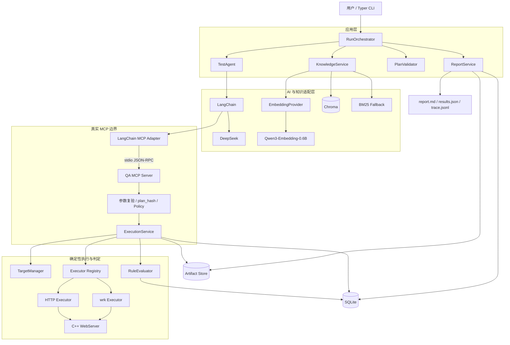
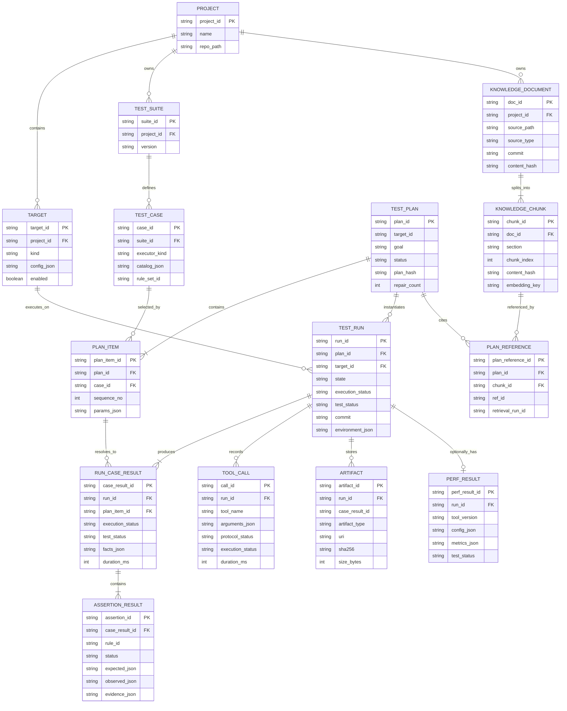
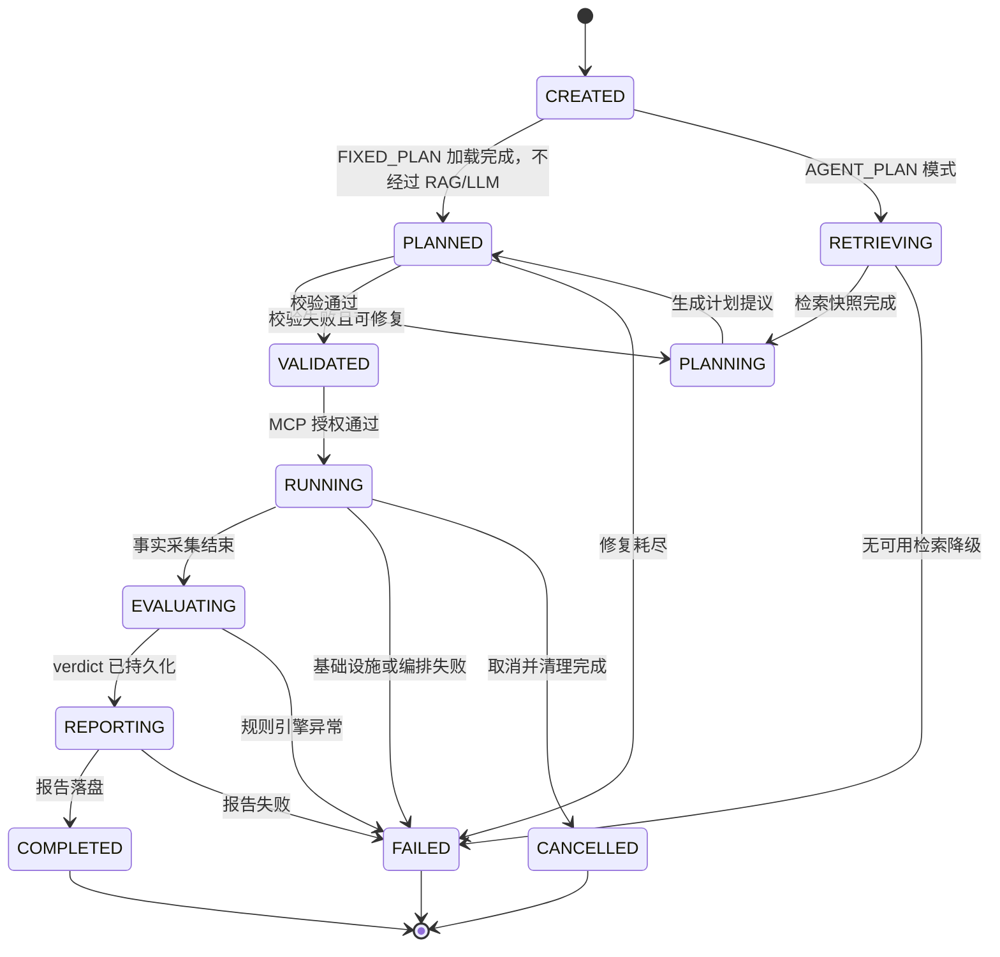

# AI 测试 Agent：企业级工程标准 MVP 开发执行规格书

> 适用场景：WSL＋VS Code＋Claude Code 插件＋外接 DeepSeek 辅助编码  
> 项目代号：`ai-qa-agent`  
> 被测对象：个人 C++ WebServer  
> 文档版本：v1.1（开发前复审修订版）  
> 文档性质：框架设计、详细设计、任务拆解、Vibe Coding 执行规范  
> 默认 Embedding：`Qwen/Qwen3-Embedding-0.6B`  
> 编写日期：2026-11-25

---

# 0. 这份文件怎么用

## 0.1 文件放置方式

在 WSL 中创建项目后，建议把本文件放到：

```text
/home/<你的用户名>/projects/ai-qa-agent/docs/IMPLEMENTATION_SPEC.md
```

然后在 VS Code 的 Claude Code 插件中，让编码模型先完整阅读本文件，再按第 18～21 章的任务包和提示词逐阶段开发。

本文件可以直接作为项目的长期实施基线。后续设计变化必须同步修改本文件或增加 ADR，不能让代码与文档长期分叉。

## 0.2 两套 DeepSeek 用途不要混淆

本项目中有两种“使用 DeepSeek”的场景：

1. **开发工具模型**：Claude Code 插件外接 DeepSeek，用来辅助你编写本项目代码。
2. **产品运行时模型**：开发完成的 `ai-qa-agent` 自己通过 LangChain 调用 DeepSeek，用来生成测试计划和总结。

二者相互独立：

- 插件能调用 DeepSeek，不代表项目代码已经接好 DeepSeek。
- 插件的 API Key 不应写入项目配置。
- 产品运行时使用自己的 `DEEPSEEK_API_KEY`，只从环境变量读取。
- 本文件不假设某个第三方 Claude Code 插件的具体配置字段；插件配置以该插件当前文档为准。

## 0.3 “企业级”在本文件中的含义

这里的企业级指**工程纪律和可维护性**，不是堆砌基础设施：

- 清晰的领域边界和依赖方向。
- 明确的数据、状态和错误契约。
- 可测试、可追溯、可回滚、可重复执行。
- 依赖锁定、静态检查、CI、代码审查和安全约束。
- 记录关键架构决策和已知限制。
- 测试失败、工具失败、环境失败严格区分。

不代表现阶段引入微服务、Kubernetes、Kafka、多租户、复杂前端或生产级高可用。

## 0.4 项目根目录 `CLAUDE.md` 最小内容

在项目根目录额外建立一个简短的 `CLAUDE.md`，让编码助手先读取规格，而不是每次复制整份文件：

```markdown
# AI QA Agent 开发约束

开始任何开发前，必须阅读 `docs/IMPLEMENTATION_SPEC.md`，并只执行用户当前指定的 Phase。

- 遵守 domain/application/adapters 依赖方向。
- 不伪造 MCP，不允许 LLM 决定 verdict，不提供任意 shell。
- 未通过 Validator 和 plan_hash 校验的计划不得执行。
- 外部进程必须设置超时并在 finally 中清理。
- 不删除、跳过或放宽失败测试来制造通过。
- 每阶段运行定向测试和 `make check`，如实报告未运行项。
- 不跨 Phase 增加功能，不自行 git commit 或 git push。
- 设计变更必须同步更新规格或 ADR。
```

## 0.5 给 Claude Code 的最高优先级约束

开发时必须遵守：

1. 先读完整规格，再编码；每个提示词只完成指定阶段，不跨阶段扩张。
2. 不伪造 MCP：必须有独立 MCP Server、真实 initialize/list/call 和结构化返回。
3. 不允许 LLM 决定最终 PASS/FAIL；规则引擎是唯一 verdict 来源。
4. 不允许模型执行任意 shell、任意文件路径或任意 URL。
5. TestPlan 只能选择 Case Catalog 中的 case_id 和受限参数。
6. 计划未通过校验，不得启动被测 Server，不得调用执行工具。
7. MCP Server 必须根据 plan_id/hash 加载已校验计划，不能信任模型重复传入的计划正文。
8. Executor 只产生事实，RuleEvaluator 只根据事实判定，Reporter 不得修改事实和 verdict。
9. 所有外部进程必须设置超时、使用参数数组、`shell=False`，并在 `finally` 中清理。
10. 不删除或绕过失败测试来制造“通过”。发现规格冲突时，先说明并给出最小修正。
11. 每阶段必须运行该阶段测试和质量检查，展示真实结果；无法运行的命令必须明确说明。
12. 不声称已经实现未实现的功能，不虚构性能提升、测试数量或评估指标。

---

# 1. 项目定义与交付边界

## 1.1 一句话定义

构建一个受约束的 AI 测试 Agent：

> RAG 提供带来源的项目知识，DeepSeek 生成结构化测试计划，确定性程序校验计划，Agent 通过真实 MCP 调用测试工具，HTTP/wrk 执行器产生事实，独立规则引擎判定结果，LLM 最后生成总结草稿。

## 1.2 MVP 交付物

- 一个 Python 模块化单体仓库。
- 一个 Typer CLI。
- 一个独立本地 QA MCP Server。
- 一个单 Agent 应用流程。
- 一个真实 C++ WebServer Target Adapter。
- 首批 6 个 HTTP 黑盒基准用例模板，Catalog 后续可扩展。
- 一个 wrk 短压测执行器。
- 一套独立规则引擎。
- 一个 RAG 知识库构建与检索流程。
- SQLite、Chroma、Artifact Store 三类存储。
- Markdown 测试报告和 JSON/JSONL 机器可读产物。
- 单元、契约、集成、E2E、RAG/Agent 评估框架。
- Ruff、mypy、pytest、pre-commit、CI 和依赖锁文件。
- README、架构说明、配置示例、运行指南和已知限制。

## 1.3 首批六条 HTTP 基准用例

这六条用于验证完整 Agent 测试链路，不是最终测试集，也不是 Catalog 的数量上限。每个模板可包含多组受限参数和多条断言；`max_cases=6` 只限制 MVP 单次 Run 选择的 case 数，后续可通过受审配置提高。

| case_id | 目的 | 主要执行方式 |
|---|---|---|
| `http.get_index` | 验证基本 GET | httpx 或受控 HTTP client |
| `http.head` | 验证 HEAD 响应语义 | 原始 socket 或可证明 body 语义的 client |
| `http.keep_alive` | 同一连接顺序发送两个请求 | socket |
| `http.pipelined` | 同一连接连续发送两个请求 | socket |
| `http.split_request` | 验证分包/半包解析 | socket 分段发送 |
| `http.path_traversal` | 验证不能读取站点根目录外文件 | 原始 socket＋受控秘密文件 fixture，禁止客户端规范化攻击路径 |

## 1.4 非目标

MVP 不实现：

- 多 Agent、前端、FastAPI、登录、多用户、多租户。
- 微服务、消息队列、分布式调度。
- 任意测试代码生成与执行。
- 任意 shell、任意文件读取、任意网络目标。
- Android、音视频、AIoT、KV Server。
- 长稳测试、完整性能容量评估、自动泄漏定论。
- 自动提交正式 Bug。
- 重写现有 C++ 测试为 pytest。

CTest、Sanitizer、KV 和 Android 都按后续插件扩展，不进入首版任务包。

---

# 2. 已冻结的技术选型

| 类别 | 冻结选型 | 备注 |
|---|---|---|
| 语言 | Python 3.11+ | WSL Ubuntu 环境 |
| 包管理 | uv＋`pyproject.toml`＋锁文件 | 不用 requirements 多处重复维护 |
| CLI | Typer | 所有演示命令可脚本化 |
| 配置 | Pydantic Settings＋YAML | 环境变量只覆盖必要项 |
| Schema | Pydantic v2 | `extra="forbid"` 优先 |
| LLM | DeepSeek＋`langchain-deepseek`，默认 `deepseek-flash` | 使用 `ChatDeepSeek`，模型名由环境变量配置 |
| Agent | LangChain `create_agent` | 规划与工具执行是受控阶段 |
| MCP Server | 官方 MCP Python SDK | 独立 stdio 子进程 |
| MCP Client | `langchain-mcp-adapters` | 锁定兼容版本，不混用新旧的示例 API |
| Embedding | `Qwen/Qwen3-Embedding-0.6B` | 通过 `sentence-transformers` 本地运行 |
| 向量库 | Chroma | cosine collection，记录模型和维度元数据 |
| 检索降级 | BM25 | 不伪装成向量检索 |
| 关系数据库 | SQLite＋SQLAlchemy 2 | Repository 接口隔离 |
| HTTP | httpx＋Python socket | 协议细节用 socket |
| 压测 | wrk | 参数数组，禁止 shell 拼接 |
| 报告 | Jinja2＋Markdown | verdict 来自数据库，不来自模板或 LLM |
| 测试 | pytest、pytest-asyncio | 真实 LLM 测试单独标记 |
| 质量 | Ruff、mypy、pre-commit | CI 执行相同命令 |
| 日志 | 标准 logging＋JSONL trace | 不保存 API Key 和模型思维链 |

## 2.1 版本策略

- 使用 uv 生成并提交锁文件，CI 按锁文件安装。
- 不盲目追逐最新主版本；先验证 LangChain、DeepSeek integration、MCP adapter 的兼容性。
- 初版不硬编码旧模型名；`DEEPSEEK_MODEL` 默认 `deepseek-flash`。
- LangChain MCP API 演进较快，本规格选择 `langchain-mcp-adapters`。若实施时决定改用当前官方 `MCPAdapter`，必须新增 ADR、锁定版本并替换所有相关示例，不能两套混写。
- 真实 LLM smoke test 通过之前，不写大量依赖具体模型行为的业务代码。

## 2.2 Embedding 冻结决策

默认：

```text
sentence-transformers
＋ Qwen/Qwen3-Embedding-0.6B
＋ Chroma cosine collection
```

约束：

- Embedding 模型只通过 `EmbeddingProvider` 注入。
- 记录 `embedding_model`、`embedding_revision`、`embedding_dim`、`normalize_embeddings`。
- 更换模型、模型 revision、向量维度或归一化策略后，必须重建 Collection。
- Collection 名称包含模型别名和维度，禁止不同模型的向量混用。
- 查询指令格式按该模型官方模型卡实现，并集中在 Qwen Adapter 中，不能散落各模块。
- 文档 chunk 与 query 使用同一模型和兼容配置。
- 模型不可用时显式降级 BM25，并在运行元数据和报告中标记。
- MVP 不使用 4B/8B，不加入 Reranker，不做无评估依据的复杂混合检索。

---

# 3. 架构决策记录（ADR 摘要）

正式开发时在 `docs/adr/` 中至少建立以下记录：

| ADR | 决策 | 原因 | 替代方案 |
|---|---|---|---|
| 0001 | 模块化单体 | MVP 交付快、排障简单 | 微服务 |
| 0002 | Ports and Adapters | 隔离模型、MCP、存储和执行技术 | 框架直接侵入业务层 |
| 0003 | 单 Agent＋确定性 Orchestrator | 保留规划能力，同时控制权限和状态 | 多 Agent、完全自主 Agent |
| 0004 | Case Catalog 白名单 | 防止虚构用例和计划/执行不一致 | 自由生成测试脚本 |
| 0005 | 独立规则引擎 | verdict 可重复、可测试、可审计 | LLM 直接判断 |
| 0006 | 独立 MCP Server | 标准工具协议和清晰权限边界 | 直接 import 工具函数 |
| 0007 | SQLite＋Chroma＋Artifact Store | 关系、向量和大证据分别存储 | 所有数据放向量库 |
| 0008 | Qwen3-Embedding-0.6B | 中英文技术资料和代码检索需求 | BGE、API Embedding |
| 0009 | 先固定计划后接 LLM | 无 AI 也能验证执行主链路 | 第一天全部依赖模型 |
| 0010 | 短压测只做 smoke | 避免无依据性能结论 | 单次 wrk 直接设性能门槛 |

每个 ADR 使用简单格式：Status、Context、Decision、Consequences、Alternatives。决策未变化时不要写长文。

---

# 4. 总体架构与依赖方向

## 4.1 系统架构



## 4.2 代码依赖规则

```text
cli / adapters / mcp_server / persistence / report
                      ↓
                 application
                      ↓
                    domain
```

强制要求：

- `domain` 不导入 LangChain、Chroma、SQLAlchemy、MCP SDK、Typer。
- `application` 只依赖 domain 和抽象 Port，不直接实例化外部服务。
- `adapters` 实现 Port，可以依赖第三方 SDK。
- `mcp_server` 是应用入口边界，只能调用应用服务，不把规则写进工具装饰器。
- `bootstrap.py` 是 composition root，负责创建并注入具体实现。
- 测试通过 Fake/Socket/临时目录替换外部实现，不依赖全局单例。

## 4.3 同步与异步边界

- LangChain/MCP 客户端和 MCP Server 使用 async。
- socket、文件、subprocess、SQLAlchemy sync 实现可能阻塞。
- 阻塞执行通过明确的线程边界调用，例如 `asyncio.to_thread`，不能阻塞 MCP event loop。
- 不在领域层到处写 async；只有真正需要异步边界的应用服务使用 async。
- 所有 async 任务必须有取消和超时处理，取消后仍执行目标清理。

---

# 5. 推荐仓库结构

```text
ai-qa-agent/
├─ pyproject.toml
├─ uv.lock
├─ README.md
├─ CLAUDE.md
├─ .editorconfig
├─ .gitignore
├─ .env.example
├─ .pre-commit-config.yaml
├─ Makefile
├─ config/
│  ├─ settings.example.yaml
│  ├─ policies/default.yaml
│  └─ cases/http.yaml
├─ docs/
│  ├─ IMPLEMENTATION_SPEC.md
│  ├─ architecture.md
│  ├─ development.md
│  └─ adr/
├─ src/ai_qa/
│  ├─ __init__.py
│  ├─ cli.py
│  ├─ bootstrap.py
│  ├─ settings.py
│  ├─ domain/
│  │  ├─ models.py
│  │  ├─ plans.py
│  │  ├─ results.py
│  │  ├─ knowledge.py
│  │  ├─ enums.py
│  │  └─ errors.py
│  ├─ application/
│  │  ├─ ports.py
│  │  ├─ orchestrator.py
│  │  ├─ execution_service.py
│  │  ├─ knowledge_service.py
│  │  └─ report_service.py
│  ├─ agent/
│  │  ├─ test_agent.py
│  │  ├─ prompts.py
│  │  └─ schemas.py
│  ├─ validation/
│  │  ├─ validator.py
│  │  ├─ catalog.py
│  │  └─ policy.py
│  ├─ knowledge/
│  │  ├─ ingest.py
│  │  ├─ chunking.py
│  │  ├─ references.py
│  │  └─ bm25.py
│  ├─ mcp_server/
│  │  ├─ __main__.py
│  │  ├─ server.py
│  │  ├─ tools.py
│  │  └─ schemas.py
│  ├─ execution/
│  │  ├─ target_manager.py
│  │  ├─ process.py
│  │  ├─ registry.py
│  │  ├─ http_executor.py
│  │  ├─ http_protocol.py
│  │  ├─ wrk_executor.py
│  │  └─ facts.py
│  ├─ rules/
│  │  ├─ base.py
│  │  ├─ registry.py
│  │  ├─ http_rules.py
│  │  ├─ perf_rules.py
│  │  └─ aggregate.py
│  ├─ adapters/
│  │  ├─ deepseek_chat.py
│  │  ├─ langchain_agent.py
│  │  ├─ langchain_mcp.py
│  │  ├─ qwen_embeddings.py
│  │  └─ chroma_store.py
│  ├─ persistence/
│  │  ├─ database.py
│  │  ├─ tables.py
│  │  ├─ migrations.py
│  │  └─ repositories.py
│  ├─ artifacts/
│  │  └─ store.py
│  └─ report/
│     ├─ markdown.py
│     └─ templates/report.md.j2
├─ tests/
│  ├─ conftest.py
│  ├─ fixtures/
│  ├─ unit/
│  ├─ contract/
│  ├─ integration/
│  ├─ e2e/
│  └─ evals/
├─ knowledge/
│  ├─ project/
│  ├─ standards/
│  ├─ tools/
│  └─ manifests/
├─ examples/
│  └─ plans/http_smoke.json
└─ artifacts/
   └─ .gitkeep
```

允许实施时做小幅文件合并，但不能破坏依赖方向和职责边界。不要一次性生成大量空文件；每个阶段只创建需要的模块。

---

# 6. 核心领域模型

## 6.1 状态枚举

```python
class TestStatus(StrEnum):
    PASS = "PASS"
    FAIL = "FAIL"
    WARN = "WARN"
    INCONCLUSIVE = "INCONCLUSIVE"
    ERROR = "ERROR"


class ExecutionStatus(StrEnum):
    SUCCEEDED = "SUCCEEDED"
    FAILED = "FAILED"
    TIMED_OUT = "TIMED_OUT"
    CANCELLED = "CANCELLED"


class RunState(StrEnum):
    CREATED = "CREATED"
    RETRIEVING = "RETRIEVING"
    PLANNING = "PLANNING"
    PLANNED = "PLANNED"
    VALIDATED = "VALIDATED"
    RUNNING = "RUNNING"
    EVALUATING = "EVALUATING"
    REPORTING = "REPORTING"
    COMPLETED = "COMPLETED"
    FAILED = "FAILED"
    CANCELLED = "CANCELLED"
```

语义约束：

- `FAIL`：执行系统成功取得证据，产品行为未满足断言。
- `ERROR`：工具、环境、协议或内部错误，不能形成正常产品结论。
- `INCONCLUSIVE`：执行可能成功，但缺少基线或证据不足。
- `WARN`：发现需要复验的疑似异常，不能直接定 Bug。
- `COMPLETED + FAIL`：测试工作流正常完成，发现产品问题。
- `FAILED + ERROR`：测试工作流本身未正常完成。

## 6.2 TestPlan

```python
class PlanItem(BaseModel):
    model_config = ConfigDict(extra="forbid")

    case_id: str
    params: dict[str, JsonValue] = Field(default_factory=dict)
    refs: list[str] = Field(default_factory=list)


class BenchmarkSpec(BaseModel):
    model_config = ConfigDict(extra="forbid")

    enabled: bool
    tool: Literal["wrk"]
    path: str
    duration_seconds: int
    connections: int
    threads: int


class RunLimits(BaseModel):
    model_config = ConfigDict(extra="forbid")

    max_cases: int = 6
    run_timeout_seconds: int = 120


class TestPlan(BaseModel):
    model_config = ConfigDict(extra="forbid")

    schema_version: Literal["1.0"]
    goal: str
    target_id: str
    items: list[PlanItem]
    benchmark: BenchmarkSpec | None = None
    limits: RunLimits
```

业务不变量：

- MVP 默认拒绝重复 case，不能先去重再静默执行；未来确需重复执行时，必须由 Catalog 显式声明并保留每次实例的序号。
- 模型不得提供 expected_status、rule 表达式或任意 Python 代码。
- 模型提供的 limits 不能超过服务端 Policy；最终使用更严格值。
- plan 持久化前进行规范化 JSON 序列化，并计算 SHA-256。
- plan repair 最多 2 次，保存初始版本、每次错误和修订版本。

## 6.3 执行事实与结果

```python
class CaseFacts(BaseModel):
    case_id: str
    started_at: datetime
    ended_at: datetime
    target: dict[str, JsonValue]
    request: dict[str, JsonValue]
    observed: dict[str, JsonValue]
    artifacts: list[ArtifactRef]
    executor_error: ErrorInfo | None = None


class AssertionResult(BaseModel):
    rule_id: str
    name: str
    status: TestStatus
    expected: JsonValue | None
    observed: JsonValue | None
    message: str
    evidence_refs: list[str]


class CaseResult(BaseModel):
    case_id: str
    execution_status: ExecutionStatus
    test_status: TestStatus
    facts: CaseFacts | None
    assertions: list[AssertionResult]
    error: ErrorInfo | None
```

原始大响应、字节流和日志不塞入 `observed`，只保留摘要、大小、hash 和 artifact 引用。

## 6.4 错误分类

至少定义：

```text
CONFIG_INVALID
TARGET_NOT_FOUND
TARGET_START_FAILED
TARGET_NOT_READY
TARGET_STOP_FAILED
PORT_UNAVAILABLE
DEPENDENCY_MISSING
PLAN_JSON_INVALID
PLAN_SCHEMA_INVALID
UNKNOWN_CASE
DUPLICATE_CASE
PARAM_NOT_ALLOWED
PARAM_INVALID
POLICY_VIOLATION
REFERENCE_INVALID
PLAN_REPAIR_EXHAUSTED
PLAN_HASH_MISMATCH
MCP_PROTOCOL_ERROR
MCP_TOOL_ERROR
TOOL_TIMEOUT
CASE_TIMEOUT
ASSERTION_FAILED
RULE_ENGINE_ERROR
ARTIFACT_WRITE_FAILED
RETRIEVAL_UNAVAILABLE
EMBEDDING_UNAVAILABLE
LLM_REQUEST_FAILED
LLM_OUTPUT_INVALID
REPORT_GENERATION_FAILED
RUN_CANCELLED
INTERNAL_ERROR
```

错误对象包含：

```json
{
  "code": "TARGET_NOT_READY",
  "message": "目标在 5 秒内未通过健康检查",
  "retryable": false,
  "details": {"health_path": "/healthz"},
  "cause_type": "TimeoutError"
}
```

`details` 不得包含 secret、完整环境变量或不受控大文本。`ASSERTION_FAILED` 只作为规则断言的结果代码，不得填入 `executor_error` 或把正常执行完成的 Case 转成基础设施 ERROR。

---

# 7. Port 接口设计

以下接口是设计意图，实施时可调整类型标注，但不能改变职责：

```python
class ChatPlanner(Protocol):
    async def propose_plan(self, request: PlanRequest) -> TestPlan: ...


class KnowledgeRetriever(Protocol):
    async def retrieve(self, query: RetrievalQuery) -> RetrievalSnapshot: ...


class EmbeddingProvider(Protocol):
    def embed_documents(self, texts: list[str]) -> list[list[float]]: ...
    def embed_query(self, text: str) -> list[float]: ...
    def metadata(self) -> EmbeddingMetadata: ...


class VectorStore(Protocol):
    def upsert(self, chunks: list[KnowledgeChunk], vectors: list[list[float]]) -> None: ...
    def search(self, query: RetrievalQuery, vector: list[float]) -> list[KnowledgeChunk]: ...


class McpToolGateway(Protocol):
    async def list_tools(self) -> list[ToolDescriptor]: ...
    async def call_tool(self, call: ToolCall) -> ToolResult: ...


class TestExecutor(Protocol):
    kind: str

    def execute(self, item: ResolvedPlanItem, context: ExecutionContext) -> CaseFacts: ...


class Rule(Protocol):
    rule_id: str

    def evaluate(self, facts: CaseFacts, context: RuleContext) -> list[AssertionResult]: ...


class RuleEvaluator(Protocol):
    def evaluate_case(self, case: ResolvedPlanItem, facts: CaseFacts) -> CaseResult: ...


class RunRepository(Protocol):
    def create_run(self, run: TestRun) -> None: ...
    def update_run(self, run: TestRun) -> None: ...
    def get_run(self, run_id: str) -> TestRun: ...


class PlanRepository(Protocol):
    def save_plan(self, plan: StoredPlan) -> None: ...
    def get_plan(self, plan_id: str) -> StoredPlan: ...


class ResultRepository(Protocol):
    def save_case_result(self, run_id: str, result: CaseResult) -> None: ...
    def list_case_results(self, run_id: str) -> list[CaseResult]: ...


class ArtifactStore(Protocol):
    def write_bytes(self, run_id: str, name: str, data: bytes, kind: str) -> ArtifactRef: ...
    def write_text(self, run_id: str, name: str, text: str, kind: str) -> ArtifactRef: ...


class ReportGenerator(Protocol):
    def generate(self, run_id: str) -> ArtifactRef: ...
```

接口隔离要求：

- 不创建一个包含所有方法的 `AIManager`。
- Repository 按业务聚合拆分，不要求每张表一个接口。
- Port 不暴露 Chroma、LangChain、SQLAlchemy 的特有对象。
- Fake 实现与真实实现必须遵守相同错误和结果契约。

---

# 8. 配置详细设计

## 8.1 `.env.example`

```dotenv
DEEPSEEK_API_KEY=
DEEPSEEK_MODEL=deepseek-flash
DEEPSEEK_BASE_URL=https://api.deepseek.com
AI_QA_CONFIG=config/settings.yaml
EMBEDDING_MODEL=Qwen/Qwen3-Embedding-0.6B
EMBEDDING_DEVICE=cpu
HF_HOME=.cache/huggingface
CHROMA_PATH=.data/chroma
SQLITE_PATH=.data/ai_qa.db
ARTIFACT_ROOT=artifacts
LOG_LEVEL=INFO
```

`.env` 必须进入 `.gitignore`；`.env.example` 不得包含真实 Key。

## 8.2 `settings.example.yaml`

```yaml
schema_version: "1.0"
project:
  project_id: cpp-webserver
  repo_root: /absolute/path/to/CPP
  knowledge_root: knowledge

target:
  target_id: cpp-webserver-local
  kind: cpp_webserver
  executable_path: /absolute/path/to/web_server
  working_directory: /absolute/path/to/CPP
  www_root: /absolute/path/to/CPP/build/www
  host: 127.0.0.1
  port: 18080
  threads: 4
  timeout_seconds: 60
  cache_bytes: 16777216
  health_path: /healthz
  startup_timeout_seconds: 10
  stop_timeout_seconds: 5

runtime:
  run_timeout_seconds: 120
  case_timeout_seconds: 8
  max_cases: 6
  max_log_chars_for_llm: 8000
  allowed_target_hosts:
    - 127.0.0.1
  allowed_processes:
    - /absolute/path/to/web_server
    - /usr/bin/wrk

knowledge:
  embedding_model: Qwen/Qwen3-Embedding-0.6B
  embedding_device: cpu
  embedding_dim: 1024
  distance: cosine
  top_k: 8
  chunk_target_tokens: 600
  chunk_overlap_ratio: 0.1

benchmark:
  enabled_by_default: false
  max_duration_seconds: 30
  max_connections: 64
  max_threads: 4
  wrk_path: /usr/bin/wrk

agent:
  max_plan_repairs: 2
  llm_timeout_seconds: 60
  max_tool_calls: 4
```

所有绝对路径由用户按 WSL 实际环境填写。Claude Code 不得编造 C++ 可执行文件位置；找不到时应给出配置错误和定位方法。

## 8.3 配置加载顺序

```text
内置安全默认值
→ YAML 配置
→ 允许的环境变量覆盖
→ CLI 中少量显式覆盖
→ Pydantic 校验
→ 路径 canonicalize
→ 输出脱敏后的 effective-config.json
```

安全策略不能通过 LLM 或 TestPlan 覆盖。CLI 若允许 `--allow-benchmark`，也只能打开用户已配置的本机短压测，不得突破最大资源限制。

---

# 9. Case Catalog 与规则绑定

## 9.1 Catalog 示例

```yaml
schema_version: "1.0"
suite_id: http_smoke
cases:
  - case_id: http.get_index
    executor: http
    description: 请求站点首页并验证基本 HTTP 响应
    params:
      path:
        type: http_path
        default: /
    timeout_seconds: 5
    rule_set: http.get_index
    artifact_policy: http_exchange

  - case_id: http.split_request
    executor: http
    description: 将同一请求分片发送，验证消息解析
    params:
      path:
        type: http_path
        default: /
      split_sizes:
        type: integer_list
        default: [1, 3, 7]
        min_items: 1
        max_items: 16
        min_value: 1
        max_value: 64
    timeout_seconds: 8
    rule_set: http.split_request
    artifact_policy: raw_http_exchange
```

Catalog 是代码审查后的受信配置，不是 RAG 文档。RAG 可以检索 Catalog 的人类说明，但执行时必须读取结构化 Catalog 本体。

## 9.2 ResolvedPlanItem

校验后将 Catalog 与 PlanItem 合并为内部 `ResolvedPlanItem`：

- 固定 case_id、executor、rule_set、timeout。
- 合并默认参数与合法用户参数。
- 拒绝未声明字段。
- 解析受控 fixture 和 artifact 策略。
- 不包含自然语言自由步骤。

MCP 执行器只能接收 ResolvedPlanItem，不再直接信任原始 TestPlan。

---

# 10. RAG 详细设计

## 10.1 知识来源优先级

```text
P0：当前源码契约、README、架构、Case Catalog、历史故障、测试说明
P1：RFC 9110/9112、pytest/CTest/wrk/Sanitizer/Linux 官方资料
P2：历史 benchmark 和人工审核的内部笔记
P3：其他人工筛选资料，仅补充，不覆盖标准和源码
```

## 10.2 Manifest

每个知识集合使用 manifest 管理：

```yaml
project_id: cpp-webserver
commit: <current-git-commit>
documents:
  - source_path: knowledge/project/architecture.md
    source_type: project_doc
    priority: P0
  - source_path: knowledge/standards/rfc9112-extract.md
    source_type: standard
    priority: P1
    source_url: https://www.rfc-editor.org/rfc/rfc9112
```

只索引白名单文件。不得自动遍历整个 home 目录、`.env`、密钥、构建产物或隐私文件。

## 10.3 入库算法

1. 读取 manifest 和当前项目标识。
2. 计算文档内容 SHA-256；未变化则跳过。
3. 解析 Markdown 标题层级，保留标题路径。
4. 按语义段落切块，目标约 600 tokens，重叠约 10%。
5. 代码块、表格、RFC 章节不机械从中间截断。
6. 为每个 chunk 生成稳定 `chunk_id` 和 `content_hash`。
7. Qwen Embedding 批量编码，记录模型、revision、维度、归一化。
8. 写入 Chroma，并在 SQLite 保存文档/chunk 元数据。
9. 对删除文档执行陈旧 chunk 清理。
10. 运行固定检索 smoke query，输出命中结果供人工检查。

## 10.4 Chroma Collection 规范

名称示例：

```text
cpp_webserver__qwen3_embedding_0_6b__1024__cosine
```

Collection metadata：

```json
{
  "project_id": "cpp-webserver",
  "embedding_model": "Qwen/Qwen3-Embedding-0.6B",
  "embedding_revision": "<resolved-revision>",
  "embedding_dim": 1024,
  "distance": "cosine",
  "normalize_embeddings": true,
  "schema_version": "1.0"
}
```

如果实际运行配置与 Collection metadata 不一致，拒绝复用并提示重建，不能静默混合。

## 10.5 检索算法

1. 使用 goal、target、当前 commit 构造 query。
2. 使用 Qwen Adapter 生成 query 向量。
3. 按 project、当前知识版本和允许的 source_type 过滤。
4. top_k 初始为 8，去重相邻重复 chunk。
5. P0/P1 优先，但不得简单丢弃所有其他来源。
6. 限制上下文总预算，记录被截断的候选。
7. 为每个返回 chunk 创建本次运行唯一 `ref_id`。
8. 将 `ref_id → chunk_id/content_hash/source` 固化到 RetrievalSnapshot。
9. Planner 只能引用 snapshot 中的 ref_id。
10. 如果 Embedding 初始化失败，记录原因并使用 BM25；报告标记降级。

## 10.6 RAG 评估集

`tests/evals/rag_cases.yaml` 至少 15 条：

```yaml
- question: 服务启动后使用什么路径做健康检查？
  expected_sources:
    - knowledge/project/runtime-contract.md
  expected_terms:
    - /healthz
- question: 哪些资料支持持久连接和流水线测试？
  expected_sources:
    - knowledge/standards/rfc9112-extract.md
```

指标：

- Recall@5。
- MRR。
- 无结果率。
- 引用合法率。
- 人工抽查的答案相关性。

评估结果保存到 artifacts，不写死“已达到多少”到 README，除非有真实运行记录。

---

# 11. Agent、计划校验与修复详细设计

## 11.1 单 Agent 两阶段

`TestAgent` 是应用门面：

```text
propose_plan()
  → 直接调用 ChatDeepSeek 生成 TestPlan JSON

execute_validated_plan()
  → 只有通过校验后，create_agent 才获得 MCP 执行工具
  → 模型选择 run_http_cases / run_http_benchmark / get_run_result
  → 生成总结草稿
```

这不是两个自治 Agent。阶段切换由 RunOrchestrator 决定。

## 11.2 规划输入

- System prompt：角色、权限边界、输出 Schema、禁止事项。
- 用户 goal。
- Target 摘要，不包含秘密。
- Case Catalog 摘要。
- RetrievalSnapshot 中的知识 chunk 和 ref_id。
- 当前 limits 和 benchmark 是否授权。

RAG 文本和工具输出均标记为不可信数据，不能覆盖 system 指令。

## 11.3 校验流水线

```text
JSON 解析
→ Pydantic Schema
→ Target 白名单
→ case_id 存在且启用
→ 重复 case 检查
→ 参数白名单、类型、范围
→ refs 属于当前 RetrievalSnapshot
→ run limits 与 Policy 合并
→ benchmark 授权和资源限制
→ 生成 plan_id、plan_hash
→ 持久化 VALIDATED 计划
```

校验上下文必须区分 `AGENT_PLAN` 与 `FIXED_PLAN`：Agent 模式必须携带当前 RetrievalSnapshot；固定计划模式允许没有 Snapshot 且 refs 为空，但非空 refs 仍必须可验证，其余 Schema、Catalog、Policy、plan_hash 和安全校验完全不变。固定计划不是绕过安全校验的后门。

任一阶段失败，返回统一 `ValidationIssue`：

```json
{
  "code": "PARAM_NOT_ALLOWED",
  "path": "items[0].params.command",
  "message": "该用例不允许 command 参数",
  "allowed": ["path"],
  "repairable": true
}
```

## 11.4 修复循环

```text
repair_count = 0
while plan 不合法:
    如果 repair_count >= 2：终止为 PLAN_REPAIR_EXHAUSTED
    把原计划、ValidationIssue 列表、允许 Schema 发回模型
    要求只修改错误字段，保留无关合法项
    repair_count += 1
    保存修订和 diff
```

修复失败不能执行“最相近的合法计划”，除非用户显式改为固定计划模式。

## 11.5 DeepSeek 最小 Smoke Test

在完整接入前完成独立脚本或测试：

1. 普通 JSON 输出能被 Pydantic 接收。
2. 模型能返回一个工具调用。
3. 工具结果回传后能继续生成最终响应。
4. 连续两个工具调用不丢失 call_id。
5. 非法工具参数由程序拒绝，不执行。
6. 超时、空内容、截断 JSON、API 错误均映射为 LLM 错误。
7. 思考/非思考模式只选择一种作为初版默认，记录配置。

若 LangChain 集成与所选模型模式不兼容，使用 LangChain ChatModel＋显式 Python tool-calling loop，保持上层 Port 不变，并记录 ADR。

---

# 12. MCP Server 与工具契约

## 12.1 进程与传输

- 使用官方 MCP Python SDK。
- Server 作为独立子进程运行，通过 stdio JSON-RPC 通信。
- Client 必须记录 initialize、tools/list、tools/call 的协议级 trace。
- 工具声明 inputSchema 和 outputSchema。
- 结构化结果放 `structuredContent`，同时提供 JSON text fallback。
- 客户端校验 structuredContent；服务端校验所有输入。
- 工具注解只作提示，不作为安全授权依据。
- 父进程在启动 Server 前，把配置、SQLite、Chroma 和 Artifact 的相对路径统一解析为绝对路径，通过最小必要环境传递同一个 `AI_QA_CONFIG`；Server 独立装配应用服务，不能依赖父进程内存对象。
- 执行用 MCP Server 只按需装配 Target、Executor、Rule、Repository 和 Artifact 依赖，不初始化 DeepSeek、LangChain Agent、Qwen Embedding 或 Chroma，避免无意义加载模型。
- 不向执行用 MCP Server 传递 `DEEPSEEK_API_KEY` 等它不需要的密钥。
- stdio Server 的 stdout 只能用于 MCP 协议消息；普通日志必须写 stderr 或文件，禁止使用 `print` 污染协议流。
- MVP 每个 Server 实例同一时刻只执行一个写入型 Run，避免同端口目标和资源竞争；只读查询与并发扩展后续单独设计。

## 12.2 `run_http_cases`

输入：

```json
{
  "run_id": "run_01...",
  "plan_id": "plan_01...",
  "plan_hash": "sha256:..."
}
```

服务端流程：

1. 校验 JSON Schema。
2. 查询 run、plan、target，确认匹配。
3. 重新计算 plan_hash。
4. 确认 plan 状态 VALIDATED，run 状态允许执行。
5. 确认工具调用授权和剩余额度。
6. 通过 ExecutionService 执行 ResolvedPlanItem。
7. 收集 CaseFacts 和 Artifacts。
8. 调用 RuleEvaluator，持久化断言和 CaseResult。
9. 返回统一 ToolResult。

模型不得通过该工具传入命令、工作目录、可执行文件、额外步骤或新规则。

## 12.3 `run_http_benchmark`

输入：

```json
{
  "run_id": "run_01...",
  "plan_id": "plan_01...",
  "plan_hash": "sha256:..."
}
```

服务端流程：

- 重新加载并校验 run、VALIDATED plan 和 plan_hash，直接读取计划中的 target、path、时长、连接数、线程数；模型不能在调用时另行修改这些参数。
- 校验 benchmark 是否被用户授权。
- 再次校验 target、path、时长、连接数、线程数是否符合服务端 Policy。
- 校验 wrk 可执行文件属于白名单。
- 使用参数数组启动，不经过 shell。
- 设置进程和读取超时，保存 stdout/stderr/退出码。
- 解析指标但保留原始文本。
- 无基线时性能状态为 INCONCLUSIVE。
- 资源增长最多标 WARN，不直接判泄漏。

## 12.4 `get_run_result`

输入：

```json
{"run_id": "run_01..."}
```

只读返回 Run、CaseResult、PerfResult 和 Artifact 引用，不触发重新执行。

## 12.5 统一 ToolResult

```json
{
  "call_id": "call_01...",
  "run_id": "run_01...",
  "tool": "run_http_cases",
  "execution_status": "SUCCEEDED",
  "test_status": "FAIL",
  "facts": {
    "target": {},
    "case_fact_refs": ["artifact_case_result_01"]
  },
  "case_results": [
    {
      "case_id": "http.keep_alive",
      "execution_status": "SUCCEEDED",
      "test_status": "FAIL",
      "assertions": []
    }
  ],
  "artifacts": [],
  "error": null
}
```

`facts` 只放事实摘要和引用，`case_results` 放规则引擎已经持久化的结果；二者不得由 MCP 工具包装层临时编造。返回给模型的内容可按预算裁剪，但裁剪不得改变数据库和 Artifact 中的完整结果。

错误映射：

| 情况 | MCP 表现 | execution_status | test_status |
|---|---|---|---|
| 工具正常执行，断言失败 | 正常工具结果 | SUCCEEDED | FAIL |
| 工具正常执行，全部通过 | 正常工具结果 | SUCCEEDED | PASS |
| 工具正常执行，性能无基线 | 正常工具结果 | SUCCEEDED | INCONCLUSIVE |
| Server 启动失败 | 工具执行错误 | FAILED | ERROR |
| 执行超时 | 工具执行错误/超时结果 | TIMED_OUT | ERROR 或 INCONCLUSIVE |
| 参数 Schema 错误 | 协议或工具错误，不执行 | FAILED | ERROR |
| 未知工具 | MCP 协议错误 | 无正常执行 | ERROR |

断言失败不等于 MCP transport 失败。不能为了方便把所有失败都设成 `isError=true` 后丢失分类。

## 12.6 为什么不暴露 start/stop/shell

TargetManager 生命周期由 ExecutionService 内部管理：

```text
validate config
→ create process group
→ poll /healthz
→ execute cases
→ SIGTERM
→ wait
→ terminate if needed
→ collect logs
→ verify cleanup
```

这样可以防止模型启动后忘记停止、停止错误进程或绕过执行审计。

---

# 13. HTTP Executor 与 Rule 详细设计

## 13.1 原始 HTTP 工具层

`http_protocol.py` 负责：

- 构造有限 HTTP/1.1 请求。
- socket 连接、发送、分片发送和读取超时。
- 保存原始字节的可转义表示。
- 解析状态行、headers、Content-Length、连接关闭边界。
- 对不完整响应、额外字节、重复响应和解析错误提供明确事实。
- 不在 parser 中判断最终 case verdict。

HTTP request-target 与文件系统路径是两种不同输入：request-target 必须以 `/` 开头、长度受限、不得包含 CR/LF/NUL 等控制字符、原始空格或 scheme，不得被拼入本地路径和 shell。只有安全 Catalog 可以声明 `/../`、编码穿越等攻击字符串；普通用例默认拒绝。

MVP 不要求支持所有 HTTP 特性。未支持的 chunked/trailer 等情况必须返回清晰限制，不能静默误解析。

## 13.2 用例执行要点

### GET

- 请求 `/` 或 Catalog 允许路径。
- 保存状态、headers、body hash/摘要、耗时。
- Rule 检查预期状态和消息完整性。

### HEAD

- 保存原始响应，确认没有按 GET body 读取造成误报。
- Rule 检查状态、无 body、连接是否还能按预期复用。

### keep-alive

- 同一 socket 顺序发送请求 A、读取响应 A，再发送请求 B。
- 记录两个响应和是否同一连接。
- Rule 检查两个响应边界、顺序和连接未提前关闭。

### pipelined

- 同一 socket 连续写入两个请求，再读取两个响应。
- 保存原始字节流和解析位置。
- Rule 检查响应数量和顺序。

### split request

- 按 split_sizes 循环切分请求字节。
- 每片之间可使用很小、受控的间隔；不依赖长时间 sleep。
- 对每组切分保存结果。
- Rule 检查各组响应与基线一致。

### path traversal

- 在受控测试目录创建 `www/` 与平级的 `outside_secret.txt`。
- 不读取 `/etc/passwd` 等真实敏感文件。
- 使用原始 socket 发送 Catalog 允许的穿越请求路径，保存实际发送字节；禁止 httpx、URL 库或自定义 normalize 在发送前把 `../` 消解，导致测试名实不符。
- Rule 同时检查响应不包含秘密内容和允许的安全响应行为。
- 不只依赖 404，因为自定义错误页也可能泄露内容。

## 13.3 规则接口

```python
class Rule(Protocol):
    rule_id: str

    def evaluate(self, facts: CaseFacts, context: RuleContext) -> list[AssertionResult]: ...
```

要求：

- Rule 不调用 LLM。
- Rule 不修改 CaseFacts。
- expected/observed 必须可序列化。
- 每个 FAIL 必须有 evidence_refs。
- 解析异常与产品断言失败分开。
- 同一 facts 多次执行结果完全一致。

## 13.4 聚合优先级

```text
ERROR > FAIL > INCONCLUSIVE > WARN > PASS
```

Case 和 Run 均使用该保守优先级，同时保留所有局部结果，防止整体状态掩盖细节。

---

# 14. TargetManager、wrk 与 Artifact 详细设计

## 14.1 TargetManager

C++ Server 参数根据真实项目构造：

```text
--host
--port
--root
--threads
--timeout
--cache-bytes
```

要求：

- 可执行文件、working directory、www root 先校验存在性和允许根路径。
- 默认绑定 `127.0.0.1`。
- 健康检查使用 `/healthz`。
- 不使用“杀掉占用端口的任意进程”清理。
- 使用新进程组，并记录 PID、启动时间、argv 摘要。
- SIGTERM 后等待；超时再升级终止。
- `finally` 中收集 stdout/stderr/server.log。
- 启动失败、健康检查超时和测试异常均映射不同错误。

## 14.2 wrk Executor

保存：

- wrk 路径和版本。
- 完整 argv 的脱敏表示。
- duration/connections/threads/path。
- stdout、stderr、退出码。
- RPS、延迟分布、socket errors、non-2xx 等可解析指标。
- 环境、CPU、内存、OS、commit。

MVP 默认一次 10 秒短压测，仅称 `benchmark smoke`。完整 benchmark 后续支持预热、3 次重复和中位数。

## 14.3 Artifact Store

目录：

```text
artifacts/<run_id>/
├─ plan.json
├─ plan_repairs.json
├─ retrieval_snapshot.json
├─ effective-config.json
├─ environment.json
├─ results.json
├─ trace.jsonl
├─ server.log
├─ cases/
│  ├─ http_get_index.json
│  ├─ http_head.json
│  ├─ http_keep_alive.json
│  ├─ http_pipelined.json
│  ├─ http_split_request.json
│  └─ http_path_traversal.json
├─ benchmark/
│  ├─ wrk.txt
│  └─ metrics.json
└─ report.md
```

每个 Artifact 记录：run_id、case_result_id、type、URI、MIME、size、SHA-256、created_at。

ArtifactStore 必须：

- 防止 `../` 路径逃逸。
- 原子写入或临时文件后 rename，避免半文件。
- 对写盘失败显式报错。
- 返回给 LLM 的文本另行截断，原始文件保持完整。
- 不保存 API Key、完整环境变量和无关敏感文件。

---

# 15. 数据持久化设计

## 15.1 ER 图



## 15.2 持久化不变量

- plan_hash 对规范化计划 JSON 计算。
- ToolCall 保存脱敏参数、call_id、协议状态和耗时。
- 原始大日志不进入 SQLite。
- Chroma 只负责向量检索，业务结果以 SQLite 为准。
- KnowledgeChunk 与向量通过 embedding_key 对应。
- 所有表带 created_at/必要 updated_at；时间统一 UTC 存储，报告可转本地时区。
- 外键和索引在初始化时创建；至少为 run_id、plan_id、case_result_id、chunk_id 建索引。
- CLI 与 MCP Server 可能跨进程访问同一 SQLite：启用外键、WAL 和合理 `busy_timeout`，使用短事务；数据库锁超时要映射为明确基础设施 ERROR，不能无限重试。
- SQLAlchemy Engine/Session 按线程和进程边界管理，禁止把同一个 Session 跨线程或跨 `asyncio.to_thread` 调用共享。
- 写入型 Run 在 MVP 中串行执行；不能依赖 WAL 把多写者并发变成已支持能力。
- Chroma 与 SQLite 之间不做虚假分布式事务：入库必须幂等，提供重建/对账命令，发现孤儿向量或元数据时可修复。
- MVP 可以使用受控 schema migration 脚本，但必须记录 schema version，不能无版本地隐式改表。

---

# 16. CLI、状态机与退出码

## 16.1 CLI 命令

```bash
# 校验配置，不启动服务
ai-qa doctor --config config/settings.yaml

# 构建知识库
ai-qa knowledge build --project cpp-webserver

# 检查检索效果
ai-qa knowledge search "持久连接和分包测试" --top-k 5

# 固定计划，无 LLM 主链路
ai-qa run \
  --plan examples/plans/http_smoke.json \
  --target cpp-webserver-local

# 完整 Agent Demo
ai-qa demo \
  --target cpp-webserver-local \
  --goal "验证连接复用、分包解析和路径安全" \
  --allow-benchmark

# 查看结果
ai-qa show <run_id>
```

也可以通过 `python -m ai_qa` 提供相同入口。

## 16.2 状态机



状态迁移由 Orchestrator/ExecutionService 执行，Agent 不能直接写状态。

## 16.3 CLI 退出码

| 退出码 | 含义 |
|---|---|
| 0 | 工作流完成且整体 verdict 不是 FAIL/ERROR；PASS、WARN、INCONCLUSIVE 的具体策略见下文 |
| 2 | 配置或命令参数错误 |
| 3 | 计划生成/校验失败 |
| 4 | 工作流完成，但测试 verdict 为 FAIL |
| 5 | 工具、环境或基础设施 ERROR |
| 6 | 用户取消 |
| 7 | 内部未处理错误 |

WARN/INCONCLUSIVE 的退出码策略必须在 README 明确；MVP 可让工作流完成返回 0，但报告醒目标记，CI 严格模式可另行非零。

---

# 17. 安全、日志、测试与质量门槛

## 17.1 安全基线

- 无任意 shell 工具。
- 所有 subprocess 使用 argv 数组和 `shell=False`。
- 可执行文件、目标 host、工作目录、artifact root 均有白名单。
- 所有路径 canonicalize 后检查允许根目录。
- RAG 和工具输出视为不可信数据，不能改变系统指令。
- 限制 case 数、split 数、请求大小、压测时长、连接数、工具调用数。
- 日志和 trace 脱敏，API Key 永不入库。
- 原始 HTTP 攻击 fixture 使用自建秘密文件，不读取真实敏感文件。
- benchmark 默认关闭，由 CLI 显式授权。
- 真实 MCP Server 仍需重新校验，不能信任客户端已检查。

## 17.2 Trace 事件

至少包含：

```text
run_created
retrieval_started / retrieval_completed / retrieval_degraded
plan_generated / plan_validation_failed / plan_validated
mcp_initialized / mcp_tools_listed
tool_call_requested / started / finished
target_started / ready / stopped / cleanup_failed
case_started / finished
rule_evaluation_finished
report_generated
run_completed / failed / cancelled
```

事件字段：event_id、run_id、call_id、case_id、timestamp、duration_ms、level、code、message、metadata。

不记录模型思维链；记录可审计的 prompt version、结构化输入输出摘要、工具参数、事实和错误即可。

## 17.3 测试矩阵

| 类型 | 必测内容 | 真实 LLM |
|---|---|---|
| Unit | Validator、Catalog、Policy、Rules、聚合、路径、错误映射 | 否 |
| Contract | MCP initialize/list/call、Schema、structuredContent、错误 | 否 |
| Integration | TargetManager、真实 C++ Server、HTTP Executor、Artifact | 否 |
| E2E | 固定计划经真实 MCP 到报告 | 否 |
| Agent E2E | 真实规划、修复、工具选择、总结 | 是，单独 marker |
| RAG Eval | Recall@5、MRR、引用合法率 | Embedding 可本地 |
| Fault Injection | 端口占用、目标缺失、wrk 缺失、超时、非法 JSON | 否 |

必须包含：

- 非法计划不会启动目标进程。
- 伪造 ref、旧 ref、plan_hash 不匹配被拒绝。
- Server 未启动是 ERROR，不是产品 FAIL。
- 断言失败时 MCP transport 可以成功。
- 测试抛异常后仍清理 Server。
- 同一 facts 重复 Rule 计算结果一致。
- 更换 Embedding 配置后拒绝复用旧 Collection。
- 日志截断不会截断原始 Artifact。
- 路径逃逸、额外字段、未知 case、超额 wrk 全部拒绝。

## 17.4 质量命令

Makefile 至少提供：

```bash
make setup        # 按锁文件安装开发依赖
make format       # Ruff format
make lint         # Ruff check
make typecheck    # mypy
make test         # 默认不调用真实 LLM 的测试
make test-contract
make test-e2e
make eval-rag
make check        # format 检查＋lint＋typecheck＋test
```

CI 在 Ubuntu 上至少执行：

```text
按锁文件安装
→ ruff format --check
→ ruff check
→ mypy
→ pytest unit/contract
→ 不依赖私有 C++ 路径的 smoke E2E
```

真实 C++ 集成测试若暂不能进公共 CI，应通过 marker 分离，并在本地验收记录中说明；不能偷偷跳过却宣称全部通过。

## 17.5 覆盖率原则

- 不为追求百分比测试 trivial getter。
- Validator、Rule、状态机、进程清理、MCP 契约必须重点覆盖。
- 可在 CI 设置合理的初始覆盖率门槛，但必须先得到真实基线。
- 真实 LLM 测试不进入默认 CI，避免 API Key 和不确定性阻塞所有提交。

---

# 18. 开发工作分解（WBS）与提交边界

每个阶段形成一个可审查的小步提交。提交由你人工检查后决定，Claude Code 不应未经确认自行提交或推送。

## Phase 0：仓库与工程骨架

目标：

- 建立 uv 项目、src layout、配置、CLI、质量工具、CI、ADR 模板。
- 实现 `ai-qa --help`、`ai-qa doctor` 的最小版本。
- 建立 settings、错误模型和结构化日志。

验收：

```bash
make check
ai-qa --help
ai-qa doctor --config config/settings.example.yaml
```

`doctor` 对示例绝对路径缺失可给出清晰诊断，不要求示例配置在任意机器都通过真实目标检查。

建议提交：`chore: bootstrap ai-qa-agent project`

## Phase 1：领域模型、Catalog、Validator 与 Repository

目标：

- 完成状态枚举、TestPlan、ToolResult、CaseFacts、CaseResult。
- 完成 6 个 case 的 Catalog。
- 完成四层 Validator、plan_hash 和修复上限所需模型。
- 完成 SQLite schema、Repository、ArtifactStore。

验收：

- 所有非法计划测试通过。
- plan_hash 稳定性测试通过。
- Artifact 路径逃逸测试通过。
- Repository 能保存并读取计划、运行和结果。

建议提交：`feat: add validated test plan domain`

## Phase 2：真实 C++ Target 与 6 条 HTTP 用例

目标：

- 实现 TargetManager、/healthz、进程组清理。
- 实现原始 HTTP 工具、HTTP Executor、6 条用例执行逻辑、Rule 和聚合；不强制每个 case 新建一个 Executor 类。
- 提供受控 www/secret fixture。
- 不依赖 LLM，可直接调用 ExecutionService。

验收：

- 真实 C++ Server 上 6 条用例均能产生事实和 verdict。
- 断言失败与启动失败分类正确。
- 异常后无遗留进程。
- Rule 单测覆盖主要边界。

建议提交：`feat: execute http black-box test cases`

## Phase 3：真实 MCP Server 与固定计划 E2E

目标：

- 实现独立 MCP Server 和三个工具。
- 实现服务端参数复验、plan_hash、授权和统一 ToolResult。
- 实现 MCP Client/Gateway。
- CLI 固定计划通过真实 MCP 跑通并生成结果。

验收：

- trace 中有 initialize/list/call。
- 无 LLM、无 API Key 也能执行。
- 非法参数在 Server 端仍被拒绝。
- MCP structuredContent 契约测试通过。

建议提交：`feat: expose test execution through mcp`

## Phase 4：Qwen Embedding、Chroma 与 BM25

目标：

- 实现 manifest、chunker、Qwen Embedding、Chroma Store。
- 实现 Collection metadata 和索引重建检查。
- 实现 RetrievalSnapshot、引用和 BM25 降级。
- 建立至少 15 条 RAG 评估问题。

验收：

- 文档可重复入库，变化后增量更新。
- 检索结果可回溯来源和 hash。
- 模型配置变化不会混用旧向量。
- Embedding 不可用时 BM25 明确降级。
- 输出真实 RAG 评估结果。

建议提交：`feat: add versioned project knowledge retrieval`

## Phase 5：DeepSeek、LangChain Agent 与修复循环

目标：

- 完成 DeepSeek tool-calling smoke test。
- 实现 TestAgent 两阶段。
- 实现计划生成、校验、最多 2 次修复。
- 校验成功后才提供 MCP 工具。
- 实现基于事实的总结草稿，禁止修改 verdict。

验收：

- 无合法计划时不会调用执行工具。
- 虚构 case、伪造 ref、非法参数可被拦截。
- 真实 DeepSeek 测试单独 marker。
- API 失败可降级固定计划演示。

建议提交：`feat: add constrained deepseek test agent`

## Phase 6：wrk、报告与演示体验

目标：

- 实现 wrk Executor、资源限制和原始输出解析。
- 实现 Jinja2 报告、results.json、trace.jsonl。
- 完成 `ai-qa demo` 和 `show`。
- 报告区分规则 verdict 与 LLM 总结。

验收：

- 一次命令产出完整 artifact 目录。
- wrk 缺失是 ERROR，不影响已有功能结果的可追溯性。
- 无基线时性能为 INCONCLUSIVE。
- 报告不声称长稳或自动发现泄漏。

建议提交：`feat: add benchmark smoke and traceable reports`

## Phase 7：故障注入、安全、文档与发布候选

目标：

- 补齐超时、端口冲突、工具缺失、模型异常、路径攻击测试。
- 完成 README、架构、开发文档、示例配置和已知限制。
- 执行完整质量门槛和本地真实目标验收。
- 可选：独立 `demo-bug` 分支注入一个确定性 Bug，主分支不注入。

验收：

- `make check` 通过。
- 从干净环境按 README 能安装和运行。
- Demo 可重复，失败时有固定计划降级。
- 简历和 README 只写真实完成内容。

建议提交：`docs: prepare mvp release candidate`

---

# 19. Vibe Coding 执行规范

## 19.1 每个任务包的固定循环

```text
阅读规格与相关现有代码
→ 列出本阶段文件级计划
→ 先写关键契约和失败测试
→ 小步实现
→ 运行定向测试
→ 根据真实错误修复
→ 运行阶段质量门槛
→ 检查 git diff
→ 更新必要文档
→ 人工验收后提交
→ 再进入下一阶段
```

不要：

- 一次让模型“把整个项目全部写完”。
- 同时推进 RAG、MCP、HTTP、前端等多个分支。
- 测试失败后删除断言、放宽到无意义断言或永久 skip。
- 让模型大范围重写尚未理解的模块。
- 把安装依赖、运行测试、修复代码放在无限制循环里。
- 在没有真实输出时接受“应该可以运行”。

## 19.2 每轮提示词必须包含

1. 当前阶段和明确非目标。
2. 需要阅读的本文件章节和现有文件。
3. 要创建/修改的模块。
4. 必须满足的领域不变量。
5. 要增加的测试。
6. 要运行的命令。
7. 完成后的输出格式。

## 19.3 模型输出后的人工审查清单

- 是否真的调用了工具，还是只在文本中声称？
- 是否出现 `shell=True`、任意路径、任意 URL？
- 是否把 LLM 文本当作 verdict？
- 是否有真实 MCP 子进程和协议 trace？
- 是否绕过 Validator 或 Server 端复验？
- 是否有隐式全局单例导致测试困难？
- 是否测试了失败和清理，而不只是 happy path？
- 是否引入规格外依赖或跨阶段功能？
- 是否修改了不该修改的测试？
- 是否更新 README 中实际可运行的命令？

## 19.4 处理模型犯错

- 第一次：给完整错误日志、相关测试和最小修复目标。
- 第二次：限制只修改相关文件，要求解释根因。
- 第三次仍失败：停止自动生成，人工审查设计或回退该小步；不要持续扩大改动。
- 工具/依赖不兼容：记录实际版本和错误，做一个最小复现，再调整 Adapter，不改领域模型迁就 SDK。

---

# 20. 可直接复制给 Claude Code 的主提示词

将本文件放到 `docs/IMPLEMENTATION_SPEC.md` 后，在项目根目录使用以下提示词：

```text
你是本项目的资深 Python/C++ 测试平台工程师。请先完整阅读 docs/IMPLEMENTATION_SPEC.md，并把它作为当前 MVP 的最高优先级项目规格。

本项目不是自由发挥的个人脚本，而是一个按企业级工程标准交付的模块化单体。你必须遵守：
1. domain/application/adapters 的依赖方向；
2. 单 Agent＋确定性 Orchestrator；
3. Case Catalog 白名单和四层计划校验；
4. 独立真实 MCP Server，不接受伪 MCP；
5. Executor 产事实、RuleEvaluator 判 verdict、LLM 只总结；
6. 无任意 shell、任意路径和任意 URL；
7. 所有进程有超时和 finally 清理；
8. 每阶段先测试契约，再小步实现，运行真实测试并报告结果；
9. 不跨阶段增加功能，不为了通过测试删除断言；
10. 不虚构实现、指标、工具输出或兼容性。

先不要写代码。请输出：
- 你对系统主链路的理解，不超过 15 条；
- 当前仓库与规格的差距；
- Phase 0 的文件级实施计划；
- 需要我提供的 WSL/C++ 项目实际路径或环境信息；
- 任何规格冲突或技术风险。

之后等待我发送对应 Phase 的执行提示词。每次只完成一个 Phase。
```

---

# 21. 分阶段 Vibe Coding 提示词

## 21.1 Phase 0 提示词

```text
现在只执行规格书 Phase 0，不实现业务执行器、RAG、DeepSeek 或 MCP。

先阅读规格书第 0～8、17、18 章和当前仓库。完成：
1. uv＋src layout＋开发依赖和锁文件；
2. Typer CLI、Pydantic Settings、统一错误、日志；
3. ai-qa --help 和 doctor 最小实现；
4. Ruff、mypy、pytest、pre-commit、Makefile、CI；
5. ADR 目录和规格中列出的初始 ADR；
6. 必要单元测试和开发文档。

要求：
- 不生成大量空业务文件；
- 示例配置不伪造用户真实 C++ 路径；
- doctor 对缺失依赖/路径给出结构化诊断；
- 不提交 git。

完成后运行 make check 和 CLI smoke，列出实际命令、结果、修改文件和仍需人工配置的事项。
```

## 21.2 Phase 1 提示词

```text
现在只执行 Phase 1：领域模型、Catalog、Validator、SQLite Repository 和 ArtifactStore。

先阅读规格书第 6～9、14～17 章以及 Phase 0 代码。要求：
1. 实现所有状态枚举和双状态语义；
2. 实现 TestPlan、PlanItem、CaseFacts、AssertionResult、CaseResult、ToolResult；
3. 建立 6 个 HTTP case 的结构化 Catalog；
4. 实现 Schema/Catalog/Policy/Reference 四层校验和 plan_hash；
5. 实现修复错误模型，但不接 LLM；
6. 实现 SQLite schema version、WAL/busy_timeout、Repository 和 ArtifactStore，不共享跨线程 Session；
7. 先写非法输入、固定/Agent 两种引用校验模式、路径逃逸、hash、状态聚合和 Repository 测试。

禁止实现 HTTP 执行、MCP、RAG 或 Agent。不得让 expected/rule 由模型计划自由指定。

完成后运行定向测试和 make check，报告真实结果和任何设计偏差。
```

## 21.3 Phase 2 提示词

```text
现在只执行 Phase 2：真实 C++ TargetManager、HTTP Executor、6 条用例执行逻辑和 Rule。

开始前先向我确认 WSL 中 C++ 项目根目录、可执行文件路径、www_root 和可用端口；不要猜。阅读规格书第 12～14、17 章。

实现要求：
1. 按真实 --host/--port/--root/--threads/--timeout/--cache-bytes 参数启动；
2. /healthz 就绪检查、进程组、SIGTERM、超时升级和 finally 清理；
3. 原始 socket 工具支持 keep-alive、pipelined、split request 和 path traversal，攻击路径不得被客户端 normalize；
4. 受控 www/outside_secret fixture，不读取系统敏感文件；
5. Executor 只产 CaseFacts，Rule 只产 AssertionResult；
6. ERROR/FAIL/WARN/INCONCLUSIVE 分类正确；
7. 单元、集成和清理故障测试。

不得接 MCP、RAG、DeepSeek 或 wrk。先在真实 C++ Server 上验证直接 ExecutionService 主链路。

完成后给出实际运行命令、6 条用例结果、测试结果、遗留限制；不得把启动失败写成产品 FAIL。
```

## 21.4 Phase 3 提示词

```text
现在只执行 Phase 3：真实 MCP Server、Client/Gateway 和固定计划 E2E。

阅读规格书第 12、16、17 章和现有 ExecutionService。要求：
1. 使用官方 MCP Python SDK 建立独立 stdio Server；
2. 实现 run_http_cases、run_http_benchmark 的 Schema 占位约束和 get_run_result；
   本阶段不真正执行 wrk，调用 benchmark 应返回明确的未实现/禁用错误，不得伪造成功；
3. run_http_cases 只能按 run_id/plan_id/plan_hash 加载 VALIDATED 计划；
4. 服务端重新做参数、hash、目标和 Policy 校验，通过同一绝对 AI_QA_CONFIG 独立装配，不依赖父进程内存；
5. 返回 outputSchema、structuredContent 和 JSON text fallback；stdio stdout 只传协议，普通日志走 stderr/文件；
6. 客户端记录 initialize/tools/list/tools/call trace；
7. 固定计划 CLI 经真实 MCP 执行，无 API Key 也能运行；
8. 完成协议、非法参数、断言失败与工具错误分类测试。

不要把直接函数调用称为 MCP，不实现 RAG/DeepSeek。完成后运行 MCP 契约和 E2E 测试，并展示 trace 中的真实协议事件。
```

## 21.5 Phase 4 提示词

```text
现在只执行 Phase 4：Qwen3-Embedding-0.6B、Chroma、BM25 和 RetrievalSnapshot。

阅读规格书第 2、7、10、17 章。要求：
1. 实现 manifest、结构化 Markdown chunker、文档/chunk hash；
2. 实现独立 EmbeddingProvider 和 Qwen Adapter；
3. Chroma collection 固定 cosine，并记录模型、revision、维度、归一化；
4. 配置不一致时拒绝复用旧 Collection，提供明确重建入口；
5. 查询指令格式只放 Qwen Adapter，遵循模型卡；
6. 实现来源过滤、去重、上下文预算和 ref_id snapshot；
7. Embedding 不可用时显式 BM25 降级，运行元数据可区分；
8. 建立至少 15 条人工 RAG 评估问题，输出真实 Recall@5/MRR；
9. 测试重复入库、文档更新、陈旧 chunk、伪造引用和降级。

不得修改执行器和规则，不接 DeepSeek 规划。若本机模型下载失败，记录真实错误并用小型 Fake Embedding 完成契约测试，不能声称已完成真实模型评估。
```

## 21.6 Phase 5 提示词

```text
现在只执行 Phase 5：DeepSeek、LangChain TestAgent 和计划修复循环。

阅读规格书第 11、16、17 章，先做一个最小真实模型 smoke test，确认当前锁定的 LangChain、DeepSeek、MCP adapter 能完成 JSON 计划、一轮工具调用和工具结果回传。若失败，保留错误并做最小 Adapter 调整，不改领域契约。

随后实现：
1. TestAgent.propose_plan；
2. Planner 输入只含受控 Catalog、目标和 RetrievalSnapshot；
3. 校验失败最多修复 2 次，保存版本和 diff；
4. 只有 VALIDATED 后才向 create_agent 提供 MCP 工具；
5. 限制工具调用数，记录 call_id；
6. LLM 总结只读结构化 verdict 和证据摘要，不能写 verdict；
7. Fake LLM 单元测试和真实 API marker 测试；
8. API 不可用时固定计划降级演示。

禁止引入第二个自治 Agent、LangGraph 或自由代码执行。完成后报告 smoke test、非法计划拦截、修复耗尽和真实 API 测试的实际结果。
```

## 21.7 Phase 6 提示词

```text
现在只执行 Phase 6：wrk 短压测、报告和完整 Demo。

阅读规格书第 12～17 章。要求：
1. wrk 使用白名单绝对路径、argv 数组、shell=False、资源上限和超时；run_http_benchmark 只接收 run_id/plan_id/plan_hash，参数从 VALIDATED 计划读取；
2. 保存版本、argv 摘要、stdout/stderr、退出码和环境；
3. 无基线时性能 INCONCLUSIVE，资源增长只能 WARN；
4. Jinja2 报告固定展示范围、引用、MCP 调用、断言、证据、verdict、LLM 总结和限制；
5. 完成 ai-qa demo、ai-qa show 和完整 artifact 目录；
6. wrk 缺失、超时、非法参数和报告写盘失败有测试；
7. CLI 退出码符合规格。

不加入长期性能门槛、自动泄漏判断、前端或 CTest。完成后运行一次真实 Demo，并给出实际 artifact 清单和报告路径。
```

## 21.8 Phase 7 提示词

```text
现在只执行 Phase 7：发布候选加固，不增加新功能。

阅读完整规格和 git diff。完成：
1. 故障注入、安全、取消、超时和进程清理检查；
2. 检查所有 subprocess、路径、secret、RAG 不可信输入和 MCP 服务端复验；
3. 检查任何 LLM 修改 verdict、伪 MCP、无证据 FAIL 的设计缺陷；
4. 运行 make check、contract、E2E 和可用的真实模型/真实目标测试；
5. 更新 README、development、architecture、示例配置和已知限制；
6. 对照第 22 章 DoD 逐项给出证据；
7. 不自行提交或推送，不创建 demo-bug 分支。

输出按“通过项、失败项、未验证项、剩余风险、修改文件、实际命令”组织。不得把未运行项目写成通过。
```

---

# 22. 最终 Definition of Done

只有以下各项有真实证据，MVP 才算完成：

## 功能

- [ ] 固定计划在无 LLM、无 API Key 时经真实 MCP 跑通。
- [ ] 6 条 HTTP 用例在真实 C++ WebServer 上执行。
- [ ] DeepSeek 能生成计划，非法计划不能进入执行。
- [ ] RAG 引用可回溯到文档、chunk、commit/hash。
- [ ] Qwen3-Embedding＋Chroma 可用，BM25 降级有明确标识。
- [ ] wrk 短压测保存原始输出和解析指标。
- [ ] 报告包含规则 verdict、证据和 LLM 总结草稿。

## 可信度

- [ ] LLM 无法修改 verdict。
- [ ] MCP Server 根据 plan_id/hash 执行已校验计划。
- [ ] 工具错误不被写成产品 FAIL。
- [ ] 每个 FAIL 都有断言和证据。
- [ ] 性能无基线时不判 PASS，短压测不称为长稳。
- [ ] 相同 facts 的规则结果可重复。

## 工程

- [ ] `make check` 真实通过。
- [ ] MCP 契约测试和固定计划 E2E 真实通过。
- [ ] 异常路径和进程清理有测试。
- [ ] 依赖锁定，CI 可重复。
- [ ] 无硬编码 Key、本机用户名和私有绝对路径进入版本库。
- [ ] README 从干净环境可执行。
- [ ] 已知限制和未验证项明确列出。
- [ ] 架构决策和实际代码一致。

## 演示

- [ ] 一条命令生成完整 artifact。
- [ ] 可以展示 initialize/list/call trace。
- [ ] 可以展示一个断言失败与一个环境 ERROR 的区别。
- [ ] 可以展示 RAG 引用和计划校验拦截。
- [ ] 可以解释为什么新增 Executor/Rule 不需要修改主编排。
- [ ] 没有遗留 C++ Server/wrk 进程。

---

# 23. WSL 开发前的信息准备清单

在开始 Phase 2 前，你需要准备：

```text
WSL 发行版和版本：
Python 版本：
C++ 项目 WSL 绝对路径：
C++ Server 可执行文件绝对路径：
build/www 绝对路径：
可用测试端口：
wrk 路径或安装方式：
是否允许本机下载 Qwen3-Embedding-0.6B：
可用内存/磁盘：
DeepSeek 产品运行时 API Key 是否已配置到环境变量：
```

建议：

- Python 虚拟环境、Chroma、SQLite 和模型缓存放 WSL 原生文件系统，不要优先放 `/mnt/c`，以减少跨文件系统性能和管理问题。
- C++ 项目路径必须由实际构建结果确认。
- 模型缓存和 `.data` 不提交 Git。
- API Key 不写进本规格、CLAUDE.md、README、settings YAML 或聊天提示词。
- Claude Code 的文件修改范围限制在当前 `ai-qa-agent` 仓库；读取真实 C++ 项目只用于确认契约，未经你明确要求不修改 C++ 主项目。

---

# 24. 最小演示脚本与面试展示顺序

```bash
# 1. 检查环境
ai-qa doctor --config config/settings.yaml

# 2. 构建知识库
ai-qa knowledge build --project cpp-webserver

# 3. 展示检索与引用
ai-qa knowledge search "持久连接、流水线和分包解析" --top-k 5

# 4. 先证明无 LLM 的确定性执行链
ai-qa run \
  --plan examples/plans/http_smoke.json \
  --target cpp-webserver-local

# 5. 再展示 Agent 完整链路
ai-qa demo \
  --target cpp-webserver-local \
  --goal "验证连接复用、分包解析和路径安全" \
  --allow-benchmark

# 6. 查看运行结果
ai-qa show <run_id>
```

面试展示顺序：

1. 先展示真实 C++ 被测对象和测试目标。
2. 展示 RAG 来源，而不是只展示 Chroma 里有数据。
3. 展示一个非法计划被拦截。
4. 展示真实 MCP list/call trace。
5. 展示请求响应事实和 Rule 断言。
6. 展示工具 ERROR 与产品 FAIL 的区别。
7. 展示报告、短压测边界和后续扩展。
8. 最后说明架构如何支持新增 CTest、KV、Android，不现场跨范围开发。

---

# 25. 最终执行原则

这份规格的核心不是“用了多少 AI 名词”，而是以下可验证的工程闭环：

```text
知识有来源
→ 计划有 Schema
→ 执行有权限边界
→ 工具有真实 MCP
→ 过程有原始事实
→ 判定有确定性规则
→ 失败有分类和证据
→ 报告有完整追溯
→ 系统自身有测试
→ 新能力能通过插件扩展
```

如果 Claude Code 生成的实现与这些原则冲突，应优先修正实现，而不是降低原则。若某项因时间或环境无法完成，必须明确列入“未验证项/后续迭代”，不能用文字包装成已完成。
